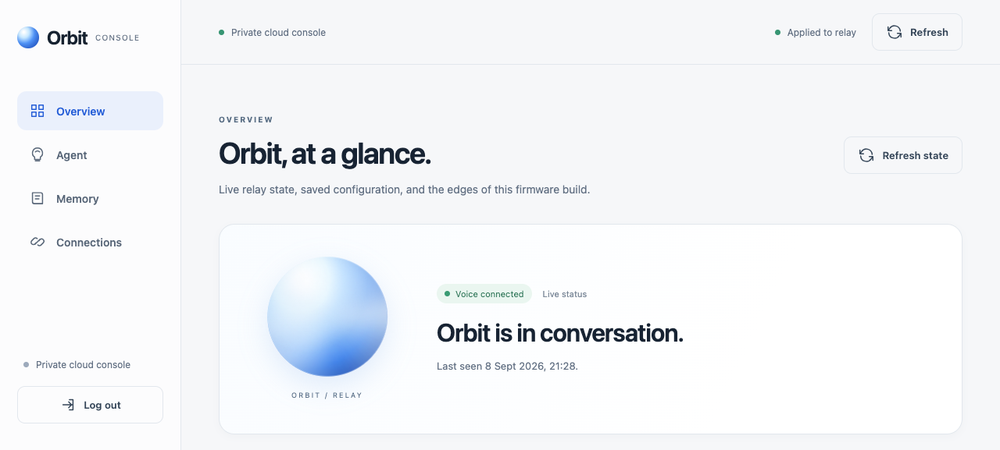
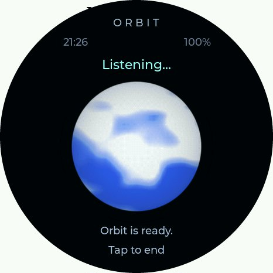
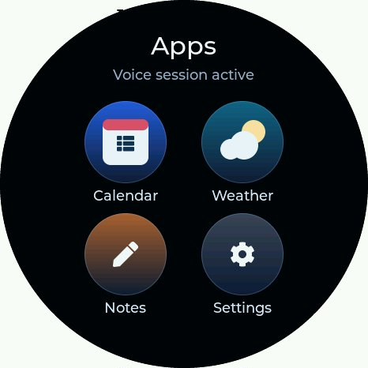
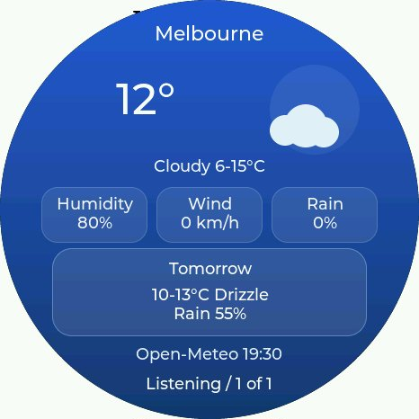
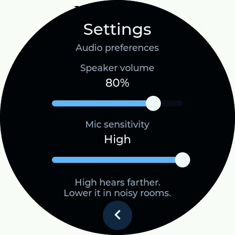
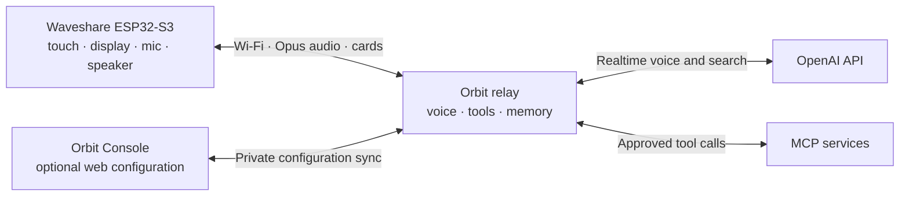

# Orbit

### A voice companion for a round ESP32 display

Orbit turns the Waveshare ESP32-S3 Touch AMOLED 1.75C into a pocket voice interface. The device shows an animated orb, listens and speaks, and presents useful information as cards. An optional web console manages the agent's instructions, explicit memories, and approved connections.

**This is an experimental, self-hosted project.** The ESP32 runs the interface and audio pipeline; an OpenAI-powered relay runs the voice agent and connected tools. Each owner needs their own API key, relay, device credentials, and optional console deployment.

<p align="center">
  
</p>
<p align="center"><em>Orbit Console — an earlier connected-state capture. The displayed status is a snapshot, not a live service indicator.</em></p>

<table>
  <tr>
    <td align="center"><br><b>Voice</b></td>
    <td align="center"><br><b>Apps</b></td>
    <td align="center"><br><b>Weather</b></td>
    <td align="center"><br><b>Settings</b></td>
  </tr>
</table>

*The four device images are captures from the 466 × 466 display. They contain no private calendar events or saved memories.*

## What it does

| On the device | Through the relay and optional console |
| --- | --- |
| Animated voice orb, touch gestures, round cards, speaker and microphone controls | OpenAI voice conversations and web search |
| Weather, calendar, notes, and settings views | Weather data, dictated notes, explicit memory, and approved MCP tools |
| Wi-Fi setup and battery status | Agent instructions, memory management, and connector configuration |

Calendar access requires an MCP connector configured by the owner. The console and relay are currently designed for **one owner and one device per deployment**; sharing an access code would share that instance's configuration and connected data.

## How it fits together



The board does not run an offline language model. OpenAI API usage is billed to the owner's key. The relay may run on a Mac or on the owner's own HTTPS host; the web console is optional.

## Get started

1. Read the [setup and security guide](ORBIT-PUBLIC.md) before building or deploying.
2. Use the **Waveshare ESP32-S3 Touch AMOLED 1.75C** board and ESP-IDF 6.0.2. The Orbit build variant is `orbit-amoled-1.75c`.
3. Create your own private device token, relay endpoint, and OpenAI API key. Configure your own 2.4 GHz Wi-Fi network on the device.
4. Run the relay locally or deploy it to your own HTTPS host. Deploy `console/` to your own Vercel project only if you want the web configuration UI.
5. Build and flash only after confirming the connected board's MAC address. The included flashing helper checks it before writing.

This source tree includes a [Fly configuration example](relay/fly.toml.example), a private-credential bootstrap helper in `relay/bootstrap.py`, and the build instructions in the [setup guide](ORBIT-PUBLIC.md). It does **not** include an API key, Wi-Fi password, live service configuration, personal data, or a prebuilt firmware image.

## Project layout

| Path | Purpose |
| --- | --- |
| `main/boards/waveshare/esp32-s3-touch-amoled-1.75/` | Waveshare board integration and Orbit display |
| `relay/` | Python voice, tools, weather, calendar, and memory service |
| `console/` | Optional web console and Vercel API |
| `docs/orbit/` | Console and real-device screenshots |
| `ORBIT-PUBLIC.md` | Setup, privacy, and deployment outline |
| `XIAOZHI-UPSTREAM.md` | Original XiaoZhi project guide |

## Current limits

- Bluetooth LE hardware does not provide Bluetooth Classic headset audio; headset pairing is not implemented.
- Spotify playback and message sending are not implemented.
- Voice quality, touch behavior, and setup need testing on each hardware revision and network.
- A single console access code controls one private deployment. Multi-user accounts and isolated user data are not implemented.

## Development checks

```sh
npm test --prefix console
relay/.venv/bin/python -m unittest discover -s relay -p 'test_*.py'
```

The second command assumes you have installed `relay/requirements.txt` into `relay/.venv`. Passing host tests does not replace a physical board test.

## Credits and licence

Orbit builds on [XiaoZhi ESP32](https://github.com/78/xiaozhi-esp32). Its [MIT licence](LICENSE) and copyright notice are retained. Read the [original XiaoZhi README](XIAOZHI-UPSTREAM.md) for the wider firmware platform. Third-party ESP-IDF components and services have their own terms.
